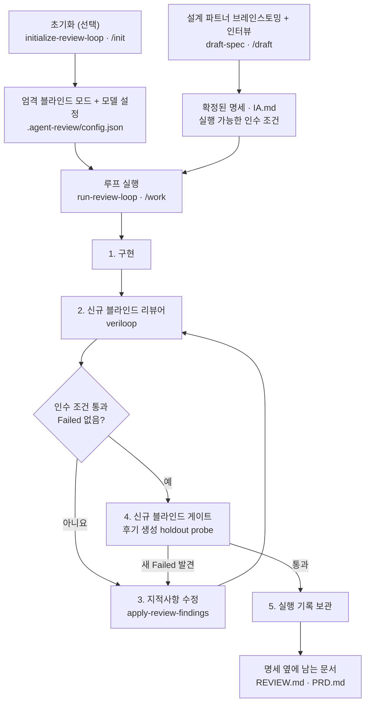

<p align="center">
  <a href="./README.md"></a>
  <a href="./README.ko.md"></a>
</p>

# Veriloop

Codex와 Claude Code에서 함께 사용하는 **명세 기반 코드 리뷰·수정 루프**입니다.

에이전트가 작성한 변경을 다섯 관점으로 검증합니다.<br>
실패 항목이 사라지고 목표의 인수 조건이 실제 명령으로 확인될 때까지 최대 3회 반복합니다.

<p align="center">
  <a href="#설치"></a>
  &nbsp;&nbsp;
  <a href="#권장-워크플로"></a>
</p>

<p align="center">
  <kbd>스킬 6</kbd>
  <kbd>리뷰 관점 5</kbd>
  <kbd>지원 Codex + Claude</kbd>
  <kbd>블라인드 모드 엄격</kbd>
</p>

<p align="center">
  <a href="https://github.com/dev-geon/veriloop/stargazers"></a>
  <a href="https://github.com/dev-geon/veriloop/releases/latest"></a>
  <a href="https://github.com/dev-geon/veriloop/blob/main/LICENSE"></a>
</p>

## 0.17.1 변경 사항

이번 패치는 이름이 같은 작업자 산출물의 보관 오류를 고치고, 실행 도중 플러그인 판이 바뀔 때의 처리를 명시합니다.

- **산출물을 스테이징 기준 상대 경로 그대로 보관합니다.**<br>
  `scripts/archive_run.py`는 모든 산출물을 `artifacts/<작업자>/<파일 이름>`으로 복사했기 때문에, 작업자가 서로 다른 폴더에 같은 이름의 파일 두 개(예: `final/summary.json`·`red/summary.json`)를 쓰면 `duplicate artifact basename`으로 거부됐습니다. 이제 `artifacts/<작업자>/<스테이징 기준 상대 경로>`로 복사하고, `artifacts[]`와 `checks[].artifact_path`의 경로도 그에 맞게 다시 씁니다.<br>
  같은 상대 경로가 두 번 나오거나, 대소문자만 다르거나, 스테이징 폴더를 벗어나는 경로는 여전히 아무것도 쓰기 전에 거부합니다. 이전 판이 보관한 실행은 그대로 둡니다.
- **실행 도중 판이 바뀌어도 형식 보정 1회 규칙을 적용합니다.**<br>
  실행 중에 플러그인을 올려 앞서 받은 리뷰·gate 객체가 새 스키마에 맞지 않으면, 같은 역할에게 같은 1회 보정을 받습니다. 역할은 새 스키마가 요구하는 것만 더하고 판정과 finding은 바꾸지 않으며, 컨트롤러가 빠진 필드를 대신 채우지 않습니다.

## 0.17.0 변경 사항

이번 버전은 종료 문서를 기계적으로 검증하고, 문서 언어를 한글로 고정하며, 서로 반복되던 지시를 정리합니다.

- **veriloop가 쓰는 모든 문서를 한글로 작성합니다.**<br>
  `IA.md`·`DECISIONS.md`·`REVIEW.md`·`PRD.md`는 대화 언어와 관계없이 한글로 쓰고, 대화는 계속 사용자 언어를 따릅니다.<br>
  코드, 식별자, 파일 경로, 명령, `AC-<n>` 식별자, 판정·심각도 표기, JSON 블록은 그대로 둡니다. `IA.md` 템플릿과 리뷰 보고서 템플릿의 제목도 한글로 바꿨습니다.
- **`PRD.md`도 `REVIEW.md`처럼 검증합니다.**<br>
  새 `scripts/check_prd.py`는 `##` 장이 빠지거나 이름·순서가 바뀌거나 추가된 경우, 빈 장, 이유 없는 `해당 없음`, 한글로 쓰지 않은 장을 거부합니다. `--spec`을 주면 `검증` 장에서 빠진 `AC-<n>` 기준과 `Pass`/`Fail`/`Deferred` 결과가 없는 기준도 거부합니다. 검증 실패는 아카이브 실패로 처리합니다.<br>
  열 개 장 제목은 루프 스킬 본문에도 그대로 두고, 이 목록과 참조 파일, 검증기가 어긋나면 계약 검사가 실패합니다.
- **종료 문서 규칙은 실행이 끝날 때만 읽습니다.**<br>
  `REVIEW.md`·`PRD.md` 작성 규칙을 `skills/run-review-loop/references/exit-documents.md`로 옮겨, 루프 스킬이 반복마다 이 내용을 싣지 않습니다.
- **불변식 오라클 정의를 한곳에 둡니다.**<br>
  `draft-spec`과 `run-review-loop`가 각자 갖던 정의를 `skills/draft-spec/references/invariant-oracle.md` 하나로 합쳤습니다.
- **반복되던 지시를 걷어냈습니다.**<br>
  본문의 gate JSON 예시(스키마가 계약), 손으로 하는 아카이브 절차(`archive_run.py`가 수행), 리뷰어용 오라클 체크리스트(리뷰 스킬이 소유), 객체별 형식 재시도 규칙(리뷰·gate 공통 규칙 하나로), 중복된 설계 파트너·모델 그룹 설명을 정리했습니다.<br>
  설계 파트너는 답변이 범위나 상태 모델을 바꿔 구현 설계가 무효가 될 때만 다시 부르고, 누락된 결정과 모순은 guess-hunt가 맡습니다.

`run-review-loop/SKILL.md`는 약 38KB에서 31KB로, `draft-spec/SKILL.md`는 약 16KB에서 15KB로 줄었습니다. 측정하지 않은 토큰 절감률은 약속하지 않습니다.

## 0.16.0 변경 사항

이번 버전은 루프를 시작하기 전에 모든 역할이 명세를 같은 뜻으로 읽는지 확인합니다.

- **명세 문장이 요구 품질 규칙을 따릅니다.**<br>
  새 `skills/draft-spec/references/requirement-quality.md`에 규칙을 둡니다. ISO/IEC/IEEE 29148의 요구 특성을 veriloop에 맞게 골라 자체 문장으로 썼기 때문에 Codex와 Claude Code가 같은 기준을 적용합니다.<br>
  범위·목표 동작·제약·수용 기준·불변식 오라클에 적용하며, 현재 동작 절은 지금처럼 `file:line` 근거로 판단합니다.
- **수용 기준마다 영구 식별자와 결과 하나를 둡니다.**<br>
  모든 기준에 `AC-<n>` 번호를 붙입니다. 삭제한 기준의 번호는 비워 두고 재사용하거나 다시 매기지 않습니다.<br>
  기준 하나는 관찰 가능한 결과 하나만 말하므로, 실패가 요구 하나를 가리키고 수정 계획의 범위도 좁게 유지됩니다. 실행 기록과 `PRD.md` 검증 장은 기준을 식별자로 인용합니다.
- **열린 기준은 결정으로 돌립니다.**<br>
  "빠르게", "등", "가능하면", "개선된" 같은 표현은 수치 경계, 완전한 집합, 기준 동작으로 바꿉니다. 대화에서 정하지 않은 값이 필요하면 문구 수정이 아니라 사용자 결정으로 되돌립니다.
- **결정 표면에 비기능 관점을 더합니다.**<br>
  성능·비용 경계, 권한, 장애 시 신뢰성은 작업이 실제로 건드릴 때만 나열하고, 확정된 속성은 검사가 붙은 수용 기준이 됩니다. 해당 사항이 없는 작업의 명세에는 절을 추가하지 않습니다.
- **guess-hunt가 모순도 찾습니다.**<br>
  세 번째 질문으로 절끼리 모순되거나, 기준이 결과 여러 개를 묶거나 기준값을 열어 두어 두 독자가 서로 다른 동작을 만들거나 판정할 수 있는지 확인합니다. 문구 취향은 보고하지 않습니다.

기준 우선순위는 이번 버전에 넣지 않았습니다. 로컬 계약 검사가 이 네 규칙도 확인합니다.

## 0.15.0 변경 사항

이번 버전은 설계·리뷰 모델의 분석을 실행 가능한 해결 설계로 정리해 워커에게 전달합니다.

- **설계 파트너가 기존 코드를 근거로 구현 설계를 만듭니다.**<br>
  `draft` 단계의 `designer`는 저장소 규칙과 관련 코드를 읽고 현재 경계, 영향받는 심볼과 데이터 계약, 상태·검증 규칙을 확인합니다. 이어서 구현 순서, 검증 사례와 제외 범위를 제안합니다.<br>
  사용자가 브레인스토밍과 인터뷰를 거쳐 확정하면 이 설계를 `IA.md`의 계약에 반영합니다.
- **리뷰어가 진단과 해결 설계를 함께 제공합니다.**<br>
  각 finding에는 불변식, 근본 원인, 영향 경로, 구현 단계, 검증 사례와 `non_goals`를 담은 bounded `repair_plan`이 들어갑니다.<br>
  리뷰어는 코드를 수정하지 않으며, 워커가 명세와 현재 코드를 대조해 계획을 검증한 뒤 구현합니다.
- **게이트에서 발견한 실패도 같은 설계 계약으로 전달합니다.**<br>
  holdout probe에서 새 Failed가 나오면 gate가 근거 기반 `repair_plan`을 만듭니다. controller는 통과한 probe와 나머지 gate 추론은 전달하지 않고, 이 계획과 최소 근거만 fixer에게 보냅니다.
- **Codex와 Claude Code가 같은 계약을 사용합니다.**<br>
  `$draft`·`/draft`, `$run-review-loop`·`/work`, 리뷰·게이트 JSON 스키마가 모두 같은 `repair_plan` 규칙을 따릅니다.

## 0.14.0 변경 사항

이번 버전은 명세 작성을 일방적인 초안 생성에서 대화형 설계 단계로 확장합니다.

- **명세 확정 과정에 설계 파트너가 참여합니다.**<br>
  저장소와 결정 표면을 근거로 정리한 뒤, 새 `designer`가 `IA.md`를 쓰기 전에 개선안·대안·트레이드오프·실행 가능한 수용 문장을 제안합니다.<br>
  controller는 한 라운드에 최대 네 개의 인터뷰 질문을 사용자에게 전달하고, 사용자의 결정을 반영한 뒤 모델이 바뀌었거나 결정이 남아 있으면 새 설계 파트너의 정합성 확인을 진행합니다. 설계 파트너는 제안하고 사용자가 확정합니다.
- **설계·리뷰·게이트와 워커를 모델 그룹으로 나눕니다.**<br>
  `.agent-review/config.json`에서 `designer`·`reviewer`·`gate`를 `design_review_gate` 그룹으로 묶고, `developer`·`fixer`를 별도의 `worker` 그룹으로 설정할 수 있습니다.<br>
  기존 역할별 `models`·`reasoning_efforts` 설정도 계속 유효하므로 기존 저장소의 설정을 강제로 바꾸지 않습니다.
- **최종 추측 탐색은 독립성을 유지합니다.**<br>
  명세 확정 직전의 guess-hunt는 설계 파트너와 다른 새 에이전트를 사용해 근거가 없는 결정과 누락된 결정을 계속 확인합니다.

## 0.13.0 변경 사항

같은 불변식이 계속 깨져 반복이 끝나지 않는 작업과, 루프 밖으로 밀려나던 검증·기록 관리를 다룹니다.

- **반복 불변식은 오라클로 올립니다.**<br>
  같은 불변식이 두 반복 이상에서 Failed 를 내거나 그 불변식으로 `no_progress`·`iteration_cap` 이 나면, 증상별 수정을 멈춥니다.<br>
  올바름이 자명한 기준(단순 모형, 최적화 전 경로, 원본 구현, 두 실행 사이의 메타모픽 관계)과 비교하는 실행형 오라클을 명세에 확정한 뒤에만 다음 수정 반복을 엽니다.<br>
  오라클에는 시드 생성기, 정규화, 예산, 과거 결함 재발견(수리를 끄면 예전 Failed 가 모두 다시 잡혀야 함)이 들어갑니다.
- **명세는 계약만 담습니다.**<br>
  `IA.md` 에는 현재 계약만 두고, 결정과 개정 이력은 옆의 `DECISIONS.md` 에 둡니다.<br>
  명세와 코드 주석에 리뷰 지적 번호나 run 번호를 쓰지 않습니다. reviewer 와 gate 는 `DECISIONS.md` 를 읽지 않습니다.
- **수용 검사를 확정 전에 한 번 돌립니다.**<br>
  draft-spec 이 모든 loop 검사를 현재 기준선에서 실행해, 명령 누락·권한·자격 증명·읽기 전용 가드 문제를 확정 전 질문으로 드러냅니다.
- **수용 기준에 단계를 둡니다.**<br>
  `loop`·`post_deploy`·`manual` 중 하나입니다. `goal_met` 은 loop 기준으로만 판정하고, 배포 후·수동 기준은 `deferred` 로 기록해 미결 항목으로 추적합니다.
- **멈춘 워커와 승계 절차를 정했습니다.**<br>
  진행이 없는 워커는 `stall_minutes`(기본 20분) 뒤 정지로 처리하고, 그 run 은 다른 차단 워커처럼 `worker_blocked` 로 끝납니다.<br>
  사용자가 승인하면 후속 run 에서 승계 워커가 이전 커밋과 미커밋 변경을 검증 대상 출발 재료로만 받아 이어 갑니다.<br>
  사전에 승인한 `fallback_models` 만 자동으로 대체하고, 대체 내역은 `run.json` 에 남깁니다.
- **임시 경로와 기록 보관을 결정적으로 만들었습니다.**<br>
  controller 가 역할마다 고유한 임시 경로를 발급합니다.<br>
  `scripts/archive_run.py` 가 산출물 복사·해시 검증·경로 재작성·스키마 검증을 마친 뒤에만 staging 을 지웁니다.
- **REVIEW.md 형식과 검증기를 정했습니다.**<br>
  맨 위 현재 상태, run 별 변화분, 끝에 `json veriloop-report` 블록 하나로 구성합니다. `scripts/check_review_report.py` 로 검증합니다.

```sh
python3 scripts/archive_run.py --agent-review .agent-review --run-json /absolute/path/draft-run.json \
  --worker /absolute/path/worker.json --gate /absolute/path/gate.json \
  --review /absolute/path/review-1.md --staging /absolute/path/staging --delete-staging
python3 scripts/check_review_report.py path/to/REVIEW.md --run-json .agent-review/runs/003/run.json
python3 evals/test_archive_run.py
python3 evals/test_review_report.py
```

`run.json` 에 새로 생긴 필드는 모두 선택이라 기존 실행 기록은 그대로 유효합니다.<br>
측정하지 않은 소요 시간·토큰 절감률을 약속하지 않습니다.

## 0.12.1 변경 사항

strict 검토와 필수 검증을 유지하면서 불필요한 수정·반복 비용을 줄였습니다.

- 관련 지적을 공통 원인별로 묶어 제한된 범위에서 수정합니다.<br>
  가능한 경우 수정 전 실패를 재현하고 보존해야 할 정상 동작도 검증합니다.
- 루프 안에서는 워커가 구조화 결과를 반환하고 controller만 보고서를 저장합니다.<br>
  단독 리뷰·수정의 문서 출력 방식은 유지합니다.
- 독립 reviewer/gate의 입력·검색·diff에서 과거 검토, 제품 결과 문서와 워커 artifact를 제외합니다.
- 수정 중에는 관련 검사, 최종 후보에는 전체 필수 수용 검사를 실행합니다.<br>
  필요한 기기 검사는 gate 전에 완료하며 controller의 독립 재검증을 유지합니다.<br>
  통과한 검사를 재실행할 때는 이유를 기록합니다.
- 과거 실행 기록을 보존하고 진전 없는 실행 뒤 사용자가 후속 실행을 승인하면 달라진 수정 접근을 명시합니다.<br>
  최대 3회 상한은 유지합니다.
- 제출 전 읽기 전용 도구로 JSON·스키마·상태 의미·정확한 검사 항목·16 KiB 제한과 artifact 참조·크기·해시·경로를 검사합니다.<br>
  실제 수용 검사나 호스트 종료 상태 검증을 대신하지 않습니다.

플러그인 저장소 루트에서 실행합니다.<br>
Python 3.10 이상이며 외부 패키지는 필요하지 않습니다.

```sh
python3 scripts/check_worker_result.py /absolute/path/result.json \
  --role fixer --staging-root /absolute/path/staging \
  --criterion "정확한 Failed 지적 제목"
python3 evals/run_contract_evals.py
python3 evals/test_worker_result_cli.py
```

검증 도구는 최초 결과 제출 전에 사용합니다.<br>
기존 형식 전용 재시도 중에는 도구를 실행하지 않습니다.<br>
정확한 역할별 모델·추론 강도, 매회 fresh 독립 검토·gate, 변경 시 gate 무효화와 필수 검사는 그대로 유지합니다.<br>
strict 전용 요청에서 컨텍스트 격리가 불가능하면 중단합니다.

개선사항을 원본과 버전 릴리스에 포함하므로 0.12.1 이상으로 업데이트해도 로컬 캐시 패치에 의존하지 않습니다.<br>
기존 실행 기록을 변환하지 않으며 측정하지 않은 토큰 절감률을 보장하지 않습니다.

## 스킬 아키텍처



`veriloop`는 단독으로도 사용할 수 있습니다.<br>
확인된 명세가 없으면 먼저 `draft-spec`으로 연결되며 명세 없는 변경을 추측으로 승인하지 않습니다.

## 권장 워크플로

| 단계 | Codex | Claude Code | 결과 |
|---|---|---|---|
| 0. 모델 그룹 설정 *(선택)* | `$initialize-review-loop` | `/init` | 엄격 블라인드 모드, 그룹 설정, findings ledger |
| 1. 작업 명세 확정 | `$draft-spec` | `/draft` | `IA.md` — 저장소 규칙과 실행 가능한 인수 조건이 포함된 명세 |
| 2. 구현·리뷰·수정 실행 | `$run-review-loop <목표>` | `/work <목표>` | 검증된 변경, `REVIEW.md`의 최종 판정, 성공 시 `PRD.md` |

### 0. 루프 초기화 *(선택)*

`design_review_gate` 그룹(`designer`·리뷰어·최종 게이트)과 `worker` 그룹(개발자·수정자)에 사용할 모델을 따로 선택합니다.

```text
# Codex
$initialize-review-loop

# Claude Code
/init
```

그룹 설정과 `"blind_mode": "strict"`는 `.agent-review/config.json`에 저장됩니다.<br>
지정한 모델을 사용할 수 없으면 다른 모델로 몰래 대체하지 않고 루프를 중단합니다.

```json
{
  "blind_mode": "strict",
  "model_groups": {
    "design_review_gate": { "model": "gpt-6-astra", "reasoning_effort": "medium" },
    "worker": { "model": "gpt-6-luna", "reasoning_effort": "xhigh" }
  }
}
```

기존 역할별 `models`·`reasoning_efforts` 맵도 계속 지원합니다. 명시된 역할별 설정은
그 역할에 우선 적용하고, 나머지 역할은 해당 그룹에서 해석합니다. 그룹 설정이 없는
기존 파일에서는 `designer`가 `reviewer`, 그 다음 `gate` 설정을 이어받고, 둘 다
없을 때만 현재 세션 모델을 사용합니다.

### 1. 명세 작성과 확인

`draft-spec`은 저장소의 `AGENTS.md` / `CLAUDE.md`, 관련 코드, 테스트, 기존 패턴을 먼저 조사합니다.<br>
계약을 쓰기 전에 설계 파트너가 개선안과 트레이드오프를 제안하고, 아직 정해지지 않은 제품 결정을 한 번에 최대 네 개의 질문으로 인터뷰합니다.<br>
그 다음 각 인수 조건에 테스트 명령이나 검색 assertion처럼 **그대로 실행할 수 있는 확인 방법**을 연결해 작업 명세를 만듭니다.

```text
# Codex
$draft-spec 차량별 연료 합계 API를 추가해줘

# Claude Code
/draft 차량별 연료 합계 API를 추가해줘
```

설계 파트너와 다른 새 에이전트가 독립적인 guess-hunt 검토를 수행해 초안에서 근거 없이 가정한 결정과 누락된 결정, 서로 모순되는 절과 기준이 열린 수용 조건을 찾아냅니다.<br>
사용자가 명세를 확인하기 전에는 구현 루프가 시작되지 않습니다.

### 2. 목표와 함께 루프 실행

목표에는 확정된 명세와 검증 가능한 완료 조건을 적습니다.

```text
# Codex
$run-review-loop docs/fleet-fuel-spec.md 기준으로 연료 합계 API를 구현하고 기존 호출자와 데이터 호환성을 유지해줘

# Claude Code
/work docs/fleet-fuel-spec.md 기준으로 연료 합계 API를 구현하고 기존 호출자와 데이터 호환성을 유지해줘
```

루프 내부에서는 다음 순서가 반복됩니다.

1. 기존 diff가 없다면 명세에 맞게 구현합니다.
2. 고유한 신규 블라인드 리뷰어가 `veriloop`의 다섯 관점으로 변경을 검토합니다.
3. 인수 조건을 실제 명령으로 실행하고 `Failed` 여부를 확인합니다.
4. 실패 항목을 수정한 뒤 다시 리뷰합니다.
5. 완료 후보를 고정하고 별도의 신규 블라인드 게이트가 구현 후 새로운 holdout probe를 생성해 검증합니다.

### 엄격한 블라인드 모드 *(기본값)*

개발자는 명세와 기본 인수 조건을 받지만 리뷰 보고서, 리뷰 체크리스트, 게이트 계획, holdout probe, 리뷰어의 추론은 받지 않습니다.<br>
매 반복 리뷰어와 최종 게이트는 서로 다른 신규 서브에이전트이며 저장소·고정된 대상·확정 명세· 범위 경계·위험 초점만 전달받습니다.<br>
ledger와 이전 기록은 controller만 관리합니다.

최종 게이트는 완료 후보가 고정된 뒤 경계값·비정상 입력, 상태 순서, 실패 주입, property/metamorphic·차등 동작, 테스트 강도와 같은 후기 생성 probe를 만듭니다.<br>
대상 작업 트리는 수정할 수 없습니다.<br>
실행 환경이 독립 컨텍스트의 신규 서브에이전트를 지원하지 않고 사용자나 저장소가 strict 검토를 요구하면 `blind_context_unavailable`로 중단합니다.<br>
strict 전용 요구가 없는 경우에만 해당 실행의 독립성 완화 여부를 묻습니다.<br>
완화 모드는 저장되지 않으며 이전 승인도 재사용하지 않습니다.

### 3. 종료와 결과 확인

루프는 아래 조건을 모두 만족해야 성공으로 끝납니다.

- 명세의 실행 가능한 인수 조건이 모두 통과
- 리뷰 판정이 `Pass` 또는 `Pass with warnings`
- 고정 snapshot이 바뀌지 않고 후기 생성 probe가 모두 통과하며 게이트에서 새로운 `Failed`가 발견되지 않음

안전장치로 최대 3회까지만 반복하며 실패 항목이 줄지 않거나 되살아나는 경우 사용자에게 판단을 요청합니다.<br>
`Warning`만 남은 경우에는 루프를 계속 돌리지 않고 각각 수용·이슈 등록·즉시 정리 중 하나로 처리합니다.

완료된 실행은 `.agent-review/runs/`에 보관됩니다.

### 루프가 남기는 문서

세 파일이 확정된 명세와 같은 폴더에 함께 놓입니다.

| 파일 | 내용 | 작성 주체 |
|---|---|---|
| `IA.md` | 명세 — 요구사항과 실행 가능한 인수 조건 | `draft-spec` |
| `REVIEW.md` | findings(severity·`file:line` 근거), 판정, 머신리더블 JSON 블록 | 단독 리뷰는 reviewer, 루프에서는 controller |
| `PRD.md` | 제품 문서 — 무엇인지·누가 쓰는지·무엇을 하는지·어떻게 동작하는지·비기능 요구, 인수 조건별 Pass/Fail과 근거를 담은 검증 장, 남은 일 | `run-review-loop`, `goal_met` 종료에서만 |

`IA.md`는 계약, `REVIEW.md`는 감사 문서입니다.<br>
`PRD.md`는 그 자리에 없던 사람에게 **지금 무엇이 존재하는가**를 설명하는 문서입니다.<br>
인수 조건 표는 그 안의 한 장이지 문서 전부가 아닙니다.<br>
반복 상한·무진전·worker 중단으로 끝난 실행은 제품 문서를 남기지 않고 그 이유를 리포트에 적습니다.

여러 작업으로 이루어진 프로그램에서는 같은 쌍이 두 계층으로 확장됩니다.<br>
상위 디렉토리의 `IA.md`·`PRD.md`가 전체를 설명하고 각 작업은 자기 디렉토리에 자기 쌍을 둡니다.

`IA.md`·`DECISIONS.md`·`REVIEW.md`·`PRD.md`는 대화 언어와 관계없이 항상 한글로 작성합니다.<br>
코드, 식별자, 파일 경로, 명령, `AC-<n>` 식별자, 판정·심각도 표기, JSON 블록은 그대로 둡니다.

#### 문서별로 무엇을 쓰는가

**`IA.md` — 계약.** 아홉 개 절을 이 순서로 둡니다.

1. 목적과 배경
2. 범위 — 포함·제외할 작업(In/Out)
3. 현재 동작 — `file:line` 근거 포함
4. 목표 동작
5. 제약 — 바꾸면 안 되는 것 포함
6. 수용 기준 — 각 기준을 검증할 정확한 확인 방법
7. 위험과 경계 사례
8. 위험 초점 — 이 변경이 가장 심각하게 실패할 수 있는 지점 한 곳
9. 참고

실행 가능한 확인 방법이 없는 조건은 구체적으로 다듬거나 제외합니다.

**`REVIEW.md` — 감사.** 지적사항(findings)은 심각한 순서로 정렬하고 각각 다음 내용을 담습니다.

- 심각도(severity): `Failed`는 변경을 막고, `Warning`은 사람이 수용할 수 있습니다.
- 근거: `file:line`과 구체적인 실패 시나리오를 적습니다.

이어서 지적사항에 따른 판정, 검사로 배제한 위험(passed checks), 자동화가 읽는 JSON 블록을 기록합니다.<br>
추정한 지적 열 건보다 검증한 지적 세 건이 낫습니다.

**`PRD.md` — 제품 문서.** 아래 열 개 장을 `##` 제목 그대로, 이 순서로 둡니다.

| # | 장 | 무엇에 답하는가 |
|---|---|---|
| 1 | 무엇인가 | 한 문단. 구현의 용어가 아니라 읽는 사람의 말로 |
| 2 | 누가 쓰는가 | 역할과 각자가 하러 오는 일 |
| 3 | 어떤 문제를 푸는가 | 이전 상황과 무엇이 달라졌는지 |
| 4 | 무엇을 하는가 | 사용자가 묶는 방식대로 묶은 기능 목록 |
| 5 | 어떻게 쓰는가 | 주 흐름 전체와 의미 있는 보조 흐름 |
| 6 | 어떻게 동작하는가 | 동작을 신뢰하려면 알아야 할 모델·데이터 흐름과 그 가정 |
| 7 | 비기능 요구 | 결정성, 결측에 대한 정직성, 접근성, 성능, 권한, 언어 |
| 8 | 검증 | 인수 조건별 Pass/Fail 과 근거 — **한 장이지 문서 전부가 아님** |
| 9 | 남은 일 | 수용한 경고, 미룬 항목, 알려진 결함과 처리 방침, 담당이 붙은 후속 작업 |
| 10 | 이 문서의 한계 | 다루지 않은 것과 주장이 기대는 근거 |

장은 작업 규모에 맞춰 늘고 줄지만(버그 하나면 장마다 한 문단, 프로그램이면 문서 전체) 자리를 아끼려고 빼지는 않습니다.<br>
해당 없으면 `해당 없음`과 이유를 씁니다.<br>
`scripts/check_prd.py`는 빠지거나 이름·순서가 바뀌거나 추가된 장, 한글로 쓰지 않은 장, `AC-<n>` 기준이나 그 `Pass`/`Fail`/`Deferred` 결과가 빠진 검증 장을 거부합니다.<br>
사실 주장은 `file:line` 으로 근거를 대고 추정은 추정이라 표시하며 해소하지 못한 불일치는 불일치로 기록합니다.

## 필요한 기능만 사용하기

### 현재 변경만 리뷰

다음처럼 자연어로 요청하거나 `$veriloop`를 직접 호출합니다.

- “에이전트가 방금 만든 변경을 리뷰해줘”
- “커밋 전에 현재 diff를 확인해줘”
- “이 브랜치를 병합해도 안전한지 검토해줘”

리뷰 범위는 **사용자가 지정한 PR·커밋·경로 → 커밋하지 않은 변경 → 기본 브랜치와 현재 브랜치의 차이** 순으로 결정됩니다.<br>
리뷰는 코드를 수정하지 않습니다.<br>
리포트는 명세 옆에 `REVIEW.md`로 저장되며 단독 리뷰는 결과 문서를 남기지 않습니다.

### 기존 리뷰 지적사항만 반영

```text
$apply-review-findings
```

`Failed` 항목을 실제 코드에서 다시 확인한 뒤 수정하고 해결된 항목은 `Pass`로 보고합니다.

## 리뷰가 확인하는 다섯 관점

| 관점 | 확인 내용 |
|---|---|
| **Regression** | 이름이 바뀐 심볼의 미수정 호출자, 직렬화 계약 파손, 몰래 완화된 테스트 |
| **Performance** | N+1 쿼리, 반복문 안 I/O, sync-over-async, 무제한 조회, 누락된 페이지네이션 |
| **Cost** | 요청량·데이터량에 따라 증가하는 API·LLM·SMS·지도·egress·로그 비용과 Cosmos DB RU |
| **Readability** | 설명만 반복하는 주석, 과도한 방어 래핑, 추측성 일반화, 죽은 코드 |
| **Conventions** | 일반론이 아니라 현재 저장소의 규칙, 린터 설정, 인접 코드 패턴과의 차이 |

모든 finding은 실제 코드에서 재검증되며 `Confirmed` 또는 `Needs verification`으로 표시됩니다.<br>
결과는 `Failed`와 `Warning`으로 분류하고 최종 판정은 `Pass`, `Pass with warnings`, `Fail` 중 하나입니다.<br>
문제가 발견되지 않은 검사와 수정 완료된 finding도 명시적으로 `Pass`로 남깁니다.

## 설치

### Codex

```bash
codex plugin marketplace add dev-geon/veriloop
codex plugin add veriloop@veriloop
```

설치 후 새 Codex 작업을 시작하면 번들 스킬이 검색됩니다.

### Claude Code

```text
/plugin marketplace add dev-geon/veriloop
/plugin install veriloop@veriloop
```

별도 설정 없이 사용할 수 있으며 리뷰할 때마다 현재 저장소의 규칙을 읽습니다.

## 실행 기록과 CI

| 경로 | 용도 |
|---|---|
| `.agent-review/config.json` | 루프 역할별 모델 설정 |
| `.agent-review/ledger.json` | 반복을 가로지르는 finding 상태: open, Pass, recurred, accepted |
| `.agent-review/runs/` | 완료된 실행 기록(`scripts/archive_run.py` 로 보관) |
| 명세 옆 `DECISIONS.md` | 명세의 결정·개정 이력. reviewer 와 gate 는 읽지 않습니다 |

### 자동화 신뢰성

| 계층 | 설명 |
|---|---|
| **공통 워크플로 코어** | Codex 스킬과 Claude Code 슬래시 명령이 동일한 명세·리뷰·수정·게이트 지침을 사용해 두 플랫폼에서 하나의 동작 계약을 따릅니다. |
| **역할 격리 전달** | 개발자·수정자·리뷰어·게이트·controller는 각 책임에 필요한 입력만 받습니다. 개발자와 수정자의 완료 상태는 성공과 timeout·취소·컨텍스트 한도·도구 실패·잘못된 결과를 명시적으로 구분합니다. |
| **스키마 기반 결과** | worker·리뷰·게이트·실행 기록은 `schemas/`의 JSON Schema를 따릅니다. worker 결과는 16KiB로 제한하며 긴 로그는 검증된 artifact로 보관하고 정상 경로에서는 controller나 reviewer 컨텍스트에 넣지 않습니다. |
| **Controller 계약 회귀 검사** | 외부 의존성이 없는 로컬 검사가 실제 fixture assertion을 실행하고 strict/reduced 전환, 신규 리뷰어 식별자, 최종 revision 인수 조건, 고정 snapshot, archive 일관성, no-progress 중단, 게이트 실패 복구를 실제 모델 실행 전에 검증합니다. |

```bash
python3 evals/run_contract_evals.py
```

이 검사는 API 호출 없이 핵심 controller trace 3개, 명시적으로 승인된 reduced 전환 1개, worker 종료 전환 3개, 워크플로 적대적 변형 24개, 정상 worker 결과 7개, worker 결과 변형 21개, raw-JSON fallback 경로 6개, 단계·오라클·승계 확장 3개와 그 적대적 변형 7개를 확인합니다.<br>
오케스트레이션 기록과 실행 증거를 검증하는 용도이며 실제 모델 컨텍스트 격리와 주관적인 리뷰 품질은 신규 서브에이전트를 사용하는 live forward test로 확인해야 합니다.

모든 리뷰 보고서 끝에는 `verdict`와 `findings[]`를 포함한 기계 판독용 JSON 블록이 붙습니다.<br>
스키마 설명, 로컬 계약 검사, GitHub Actions 게이트, Claude Code Stop hook 연결 방법은 [docs/ci.md](docs/ci.md)를 참고하세요.

> **Claude Code 전용:** 루프를 직접 실행하지 않은 세션까지 매번 강제로 리뷰하려면 사용자 설정에 Stop hook을 연결해야 합니다. 이는 사용자별 실행 환경 설정이므로 플러그인이 자동 설치하지 않습니다.

## 저장소 구조

<details>
<summary>플러그인 파일 구성 보기</summary>

```text
.agents/plugins/marketplace.json  # Codex Git marketplace entry
.codex-plugin/plugin.json         # Codex plugin manifest
.claude-plugin/plugin.json        # Claude Code plugin manifest
commands/
├── init.md                       # 초기화를 위한 얇은 Claude 진입점
├── draft.md                      # 명세 작성을 위한 얇은 Claude 진입점
└── work.md                       # 공통 루프를 호출하는 얇은 Claude 진입점
skills/
├── initialize-review-loop/       # 역할별 모델과 ledger 초기화
├── draft-spec/                   # 저장소 분석 → 명세 초안 → 사용자 확인
├── run-review-loop/              # 구현 → 리뷰 → 수정 → 최종 게이트
├── veriloop/                     # 다섯 관점의 독립 블라인드 리뷰
└── apply-review-findings/        # 검증된 지적사항 수정
schemas/                           # worker·리뷰·게이트·실행 기록·REVIEW.md 요약 계약
scripts/                           # worker 결과 검사·실행 기록 보관·REVIEW.md·PRD.md 검증 도구
evals/                             # 실행 가능한 controller trace와 적대적 변형
```

</details>

## 라이선스

MIT
