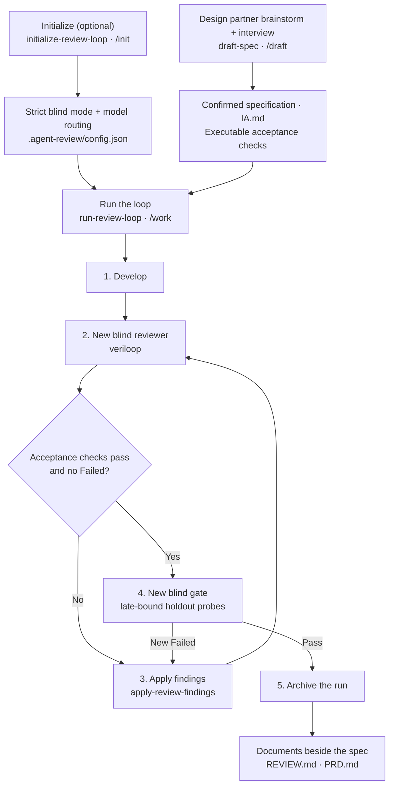

<p align="center">
  <a href="./README.md"></a>
  <a href="./README.ko.md"></a>
</p>

# Veriloop

A **spec-grounded code review and repair loop** for Codex and Claude Code.

It checks agent-written changes from five perspectives.<br>
The loop repeats for up to three iterations until no failed finding remains and the goal's acceptance checks pass as executable commands.

<p align="center">
  <a href="#install"></a>
  &nbsp;&nbsp;
  <a href="#recommended-workflow"></a>
</p>

<p align="center">
  <kbd>skills 6</kbd>
  <kbd>review passes 5</kbd>
  <kbd>platforms Codex + Claude</kbd>
  <kbd>blind mode strict</kbd>
</p>

<p align="center">
  <a href="https://github.com/dev-geon/veriloop/stargazers"></a>
  <a href="https://github.com/dev-geon/veriloop/releases/latest"></a>
  <a href="https://github.com/dev-geon/veriloop/blob/main/LICENSE"></a>
</p>

## Changes in 0.15.0

This release carries the strongest design and review model's analysis to the worker as an executable repair design.

- **The design partner produces an implementation design from the existing code.**<br>
  During `draft`, the `designer` reads repository rules and the affected code, then proposes the current boundaries, affected symbols and data contracts, state and validation rules, implementation seams, verification cases, and non-goals.<br>
  The user closes the decisions, and the accepted design is carried into `IA.md` as the contract.
- **Reviewers provide diagnosis and repair design together.**<br>
  Every finding includes a bounded `repair_plan` with the invariant, root cause, affected paths, implementation steps, verification cases, and non-goals.<br>
  Reviewers remain read-only; the worker compares the plan with the specification and current code before implementing it.
- **Gate failures use the same design contract.**<br>
  When a holdout probe finds a new Failed issue, the gate creates an evidence-grounded `repair_plan`, and the controller sends only that plan and minimal evidence to the fixer without passing probes or unrelated gate reasoning.
- **Codex and Claude Code share the contract.**<br>
  `$draft` and `/draft`, `$run-review-loop` and `/work`, and the review and gate JSON schemas all use the same `repair_plan` rules.

## Changes in 0.14.0

This release makes specification work an interactive design step instead of a one-way draft.

- **Bring a design partner into specification confirmation.**<br>
  After the repository and decision surface are grounded, a fresh `designer` proposes improvements, alternatives, trade-offs, and executable acceptance sentences before `IA.md` is written.<br>
  The controller relays up to four interview questions per round, records the user's decisions, and repeats a fresh coherence pass when those decisions change the model. The design partner suggests; the user confirms.
- **Configure model groups for design, review, gate, and workers.**<br>
  `.agent-review/config.json` can assign one `design_review_gate` group to `designer`, `reviewer`, and `gate`, and a separate `worker` group to `developer` and `fixer`.<br>
  Existing per-role `models` and `reasoning_efforts` configurations remain valid, so repositories can adopt groups without rewriting current state.
- **Keep the final guess hunt independent.**<br>
  The pre-confirmation guess-hunt uses a fresh agent distinct from every design partner and continues to check grounding and missing decisions.

## Changes in 0.13.0

This release targets work that never converges because the same invariant keeps failing, and verification or record keeping that used to slip outside the loop.

- **Escalate a recurring invariant to an oracle.**<br>
  When one invariant produces Failed findings in two iterations, or causes `no_progress`/`iteration_cap`, symptom-by-symptom repair stops.<br>
  The next repair iteration opens only after the specification holds a confirmed executable oracle that compares the implementation with a reference that is correct by construction (a simpler model, the unoptimized path, the original implementation, or a metamorphic relation).<br>
  The oracle states a seeded generator, normalization, budgets, and strength: with each repair disabled, every historical Failed finding must be detected again.
- **Keep the specification a contract.**<br>
  `IA.md` holds only the current contract; decisions and revision history live in a sibling `DECISIONS.md`.<br>
  Specs and code comments never cite finding identifiers or run numbers, and reviewers and gates do not read `DECISIONS.md`.
- **Preflight acceptance checks before confirmation.**<br>
  draft-spec runs every loop-phase check once on the current baseline, so missing commands, permissions, credentials, and read-only guards surface as questions instead of mid-batch blockers.
- **Give acceptance criteria a phase.**<br>
  `loop`, `post_deploy`, or `manual`. Only loop criteria decide `goal_met`; post-deploy and manual criteria are recorded as `deferred` and tracked as open items.
- **Handle stalled workers and successors.**<br>
  A worker without progress for `stall_minutes` (default 20) is treated as stalled, and its run ends as `worker_blocked` like any other blocked worker.<br>
  With the user's authorization, a successor continues in a follow-up run from the predecessor's commits and uncommitted diff as untrusted starting material.<br>
  Only pre-authorized `fallback_models` substitute automatically, and each substitution is recorded in `run.json`.
- **Make temporary paths and archiving deterministic.**<br>
  The controller issues a unique temporary path per role.<br>
  `scripts/archive_run.py` copies and digest-verifies artifacts, rewrites archived paths, validates every record, and only then deletes staging.
- **Define the REVIEW.md layout and validate it.**<br>
  A current-state section first, one delta section per run, and exactly one `json veriloop-report` block at the end, checked by `scripts/check_review_report.py`.

```sh
python3 scripts/archive_run.py --agent-review .agent-review --run-json /absolute/path/draft-run.json \
  --worker /absolute/path/worker.json --gate /absolute/path/gate.json \
  --review /absolute/path/review-1.md --staging /absolute/path/staging --delete-staging
python3 scripts/check_review_report.py path/to/REVIEW.md --run-json .agent-review/runs/003/run.json
python3 evals/test_archive_run.py
python3 evals/test_review_report.py
```

Every new `run.json` field is optional, so existing run archives stay valid.<br>
No measured time or token savings are implied.

## Changes in 0.12.1

This release reduces avoidable repair-loop work without weakening strict review or required verification.

- Repair related findings as one bounded root-cause group.<br>
  Reproduce failures where practical and verify normal behavior that must remain valid.
- In loop mode, workers return structured results and the controller alone persists reports.<br>
  Standalone review and repair keep their documented report behavior.
- Exclude review histories, product outcome documents and worker artifacts from blind reviewer/gate inputs, searches and diffs.
- Run local checks during repair and full required acceptance on the final candidate, including required device checks before gate.<br>
  Retain independent controller verification; repeat passed checks only for a recorded reason.
- Keep prior archives and require a changed repair approach before a user-authorized follow-up run after no progress.<br>
  The three-iteration cap remains unchanged.
- Validate worker payloads before submission with the read-only helper below.<br>
  It checks JSON/schema, semantic status, exact criteria, the 16 KiB limit and artifact references, sizes, hashes and containment.<br>
  It does not execute acceptance checks or replace transport-status validation.

From the plugin repository root (Python 3.10 or later, standard library only):

```sh
python3 scripts/check_worker_result.py /absolute/path/result.json \
  --role fixer --staging-root /absolute/path/staging \
  --criterion "Exact Failed finding title"
python3 evals/run_contract_evals.py
python3 evals/test_worker_result_cli.py
```

Run the helper before the original submission; the existing format-only retry stays tool-free.<br>
Exact role models/efforts, fresh independent reviewers and gates, snapshot invalidation, and mandatory checks remain in force.<br>
Strict-only requests fail closed when isolation is unavailable.

These changes ship in the plugin source and versioned release, so updating to 0.12.1 or later does not depend on a local cache patch.<br>
They do not migrate existing run archives or imply a measured token-savings percentage.

## Skill architecture



`veriloop` also works on its own.<br>
If there is no confirmed specification, it routes to `draft-spec` first instead of approving spec-less work by guesswork.

## Recommended workflow

| Step | Codex | Claude Code | Output |
|---|---|---|---|
| 0. Configure model groups *(optional)* | `$initialize-review-loop` | `/init` | Strict blind mode, group routing, and findings ledger |
| 1. Confirm the work specification | `$draft-spec` | `/draft` | `IA.md` — a repository-grounded spec with executable acceptance checks |
| 2. Develop, review, and repair | `$run-review-loop <goal>` | `/work <goal>` | Verified changes, a final verdict in `REVIEW.md`, and `PRD.md` on success |

### 0. Initialize the loop *(optional)*

Choose the model for the `design_review_gate` group (`designer`, reviewer, and final gate)
separately from the `worker` group (`developer` and fixer).

```text
# Codex
$initialize-review-loop

# Claude Code
/init
```

The group selection and `"blind_mode": "strict"` are stored in `.agent-review/config.json`.<br>
If a configured model is unavailable, the loop stops instead of silently substituting another one.

```json
{
  "blind_mode": "strict",
  "model_groups": {
    "design_review_gate": { "model": "gpt-6-astra", "reasoning_effort": "medium" },
    "worker": { "model": "gpt-6-luna", "reasoning_effort": "xhigh" }
  }
}
```

The previous per-role `models` and `reasoning_efforts` maps remain supported. An
explicit legacy role entry wins for that role; other roles resolve from their group.
In a legacy-only file, `designer` follows `reviewer`, then `gate`, before falling back
to the current session model.

### 1. Draft and confirm the specification

`draft-spec` first inspects the repository's `AGENTS.md` / `CLAUDE.md`, relevant code, tests, and established patterns.<br>
Before writing the contract, its design partner proposes improvements and trade-offs and interviews you about unresolved product decisions in rounds of at most four questions.<br>
It then writes a work specification in which every acceptance criterion is paired with a command that can actually verify it, such as a test or a grep assertion.

```text
# Codex
$draft-spec add a per-vehicle fuel total API

# Claude Code
/draft add a per-vehicle fuel total API
```

Before you confirm the draft, an independent guess-hunt review, using a fresh agent separate from the design partner, looks for decisions that were assumed rather than grounded in the repository or your intent.<br>
The implementation loop does not start until you confirm the specification.

### 2. Run the loop with an explicit goal

The goal should cite the confirmed specification and state the verifiable outcome.

```text
# Codex
$run-review-loop implement the fuel-total API per docs/fleet-fuel-spec.md while preserving existing data and callers

# Claude Code
/work implement the fuel-total API per docs/fleet-fuel-spec.md while preserving existing data and callers
```

Each iteration follows the same sequence:

1. Implement the specification, unless the target diff already exists.
2. Create a unique blind reviewer and run `veriloop` across five focused passes.
3. Run the acceptance checks and inspect the review for `Failed` findings.
4. Repair verified failures, then review again.
5. Freeze the candidate, then create a different blind gate that generates new holdout probes after implementation.

### Strict blind mode *(default)*

Developers receive the specification and basic acceptance checks, but not review reports, the review checklist, gate plans, holdout probes, or reviewer reasoning.<br>
Every iteration reviewer and final gate is a different, fresh subagent.<br>
Each receives only the repository, frozen target, confirmed specification, scope bounds, and risk focus.<br>
The controller keeps the ledger and all prior history.

The final gate creates new probes after the candidate is frozen: boundary and invalid inputs, state ordering, failure injection, property/metamorphic or differential behavior, and test-strength checks.<br>
It cannot modify the target worktree.<br>
If the host cannot provide an independent, fresh subagent context and the user or repository requires strict review, the loop stops with `blind_context_unavailable`.<br>
Only when strict-only review is not required does it ask whether you authorize reduced independence for that run.<br>
Relaxed mode is never persisted or inferred from an earlier approval.

### 3. Stop and inspect the result

The loop succeeds only when all of these conditions hold:

- Every executable acceptance check in the specification passes.
- The review verdict is `Pass` or `Pass with warnings`.
- The frozen snapshot is unchanged, every late-bound gate probe passes, and the gate finds no new `Failed` item.

The loop is capped at three iterations.<br>
If failures stop decreasing or recur, it escalates the decision to you.<br>
Warnings do not keep the loop running; each remaining warning is explicitly accepted, filed as follow-up work, or fixed now.

Completed runs are archived under `.agent-review/runs/`.

### Documents the loop leaves behind

Three files sit together in the work's own directory, beside the confirmed specification:

| File | Contents | Written by |
|---|---|---|
| `IA.md` | The specification: requirements and executable acceptance criteria | `draft-spec` |
| `REVIEW.md` | Findings with severity and `file:line` evidence, the verdict, and the machine-readable JSON block | reviewer for standalone reviews; controller inside the loop |
| `PRD.md` | The product document: what the thing is, who uses it, what it does, how it works, its non-functional properties, a verification chapter with every acceptance criterion's Pass/Fail and evidence, and what remains | `run-review-loop`, only on a `goal_met` exit |

`IA.md` is the contract, `REVIEW.md` is the audit, and `PRD.md` is the description of what now exists — written for someone who was not in the room.<br>
The acceptance-criteria table is one chapter of it, not the whole document.<br>
A run that stops at the iteration cap, makes no progress, or loses a worker writes no product document, and the report says why.

When a program spans many pieces of work, the pair scales: a program-level `IA.md` and `PRD.md` describe the whole in the parent directory, while each piece keeps its own pair beside it.

#### What goes in each document

**`IA.md` — the contract.** Nine sections, in this order:

1. Purpose and background
2. Scope — explicitly include and exclude work (In/Out)
3. Current behavior — with `file:line` evidence
4. Target behavior
5. Constraints — including what must not change
6. Acceptance criteria — each paired with the exact check that verifies it
7. Risks and edge cases
8. Risk focus — the one area where the change could fail most severely
9. References

Make criteria without runnable checks concrete, or remove them.

**`REVIEW.md` — the audit.** Order findings by severity, with the most serious first.<br>
Include the following for each finding:

- Severity: `Failed` blocks the change; a human may accept a `Warning`.
- Evidence: a `file:line` reference and a concrete failure scenario.

Then record the verdict supported by those findings, the risks ruled out by passed checks, and the machine-readable JSON block.<br>
Three verified findings are more useful than ten speculative ones.

**`PRD.md` — the product document.** Ten chapters, in this order:

| # | Chapter | What it answers |
|---|---|---|
| 1 | What it is | One paragraph, in the reader's language |
| 2 | Who uses it | The roles, and what each comes to do |
| 3 | What problem it solves | The situation before, and what changed |
| 4 | What it does | The feature set, grouped as a user would group it |
| 5 | How it is used | The main flow end to end, plus secondary flows |
| 6 | How it works | The model or data flow needed to trust the behaviour, with its assumptions |
| 7 | Non-functional properties | Determinism, honesty about missing data, accessibility, performance, permissions, language |
| 8 | Verification | Every acceptance criterion's Pass/Fail with evidence — **one chapter, not the document** |
| 9 | What remains | Accepted warnings, deferred items, known defects with their disposition, follow-ups with an owner |
| 10 | Limits of this document | What it did not cover, and what its claims rest on |

Chapters scale with the work — a bug fix earns a paragraph each, a program earns the whole document — but none is dropped to save space; say "not applicable" and why.<br>
Ground factual claims with `file:line`, mark inference as inference, and record an unresolved discrepancy as a discrepancy rather than dropping it.

## Use only the piece you need

### Review the current change

Ask naturally or invoke `$veriloop` directly:

- “Review what the agent just changed.”
- “Check this diff before I commit.”
- “Is this branch safe to merge?”

Scope is resolved in this order: **a PR, commit range, or path you name → uncommitted changes → the current branch against the default branch's merge base**. Review mode does not modify code.<br>
The report is persisted as `REVIEW.md` beside the specification; a standalone review writes no delivery record.

### Apply an existing review report

```text
$apply-review-findings
```

The skill re-verifies each `Failed` item against the actual code, repairs it, and reports resolved findings as `Pass`.

## The five review passes

| Pass | What it checks |
|---|---|
| **Regression** | Unupdated callers of changed symbols, broken serialization contracts, silently weakened tests |
| **Performance** | N+1 queries, I/O in loops, sync-over-async, unbounded reads, missing pagination |
| **Cost** | Traffic- or data-scaled API, LLM, SMS, map, egress, logging, and Cosmos DB RU costs |
| **Readability** | Narration comments, excessive defensive wrapping, speculative generality, dead code |
| **Conventions** | The current repository's rules, linters, and neighboring patterns—not generic best practice |

Every finding is rechecked against the code and marked `Confirmed` or `Needs verification`.<br>
Results are classified as `Failed` or `Warning` and roll up to `Pass`, `Pass with warnings`, or `Fail`.<br>
Checks that found nothing—and findings that have been fixed—are reported explicitly as `Pass`.

## Install

### Codex

```bash
codex plugin marketplace add dev-geon/veriloop
codex plugin add veriloop@veriloop
```

Start a new Codex task after installation so the bundled skills are discovered.

### Claude Code

```text
/plugin marketplace add dev-geon/veriloop
/plugin install veriloop@veriloop
```

No configuration is required.<br>
The plugin discovers the repository's conventions at review time.

## Run state and CI

| Path | Purpose |
|---|---|
| `.agent-review/config.json` | Per-role model routing |
| `.agent-review/ledger.json` | Finding state across iterations: open, Pass, recurred, accepted |
| `.agent-review/runs/` | Archived run records (written by `scripts/archive_run.py`) |
| `DECISIONS.md` beside the spec | Decision and revision history of the spec; reviewers and gates do not read it |

### Automation reliability

| Layer | Description |
|---|---|
| **Shared workflow core** | Codex skills and Claude Code slash commands route to the same specification, review, repair, and gate instructions so both platforms follow one behavior contract. |
| **Role-isolated handoffs** | Developer, fixer, reviewer, gate, and controller receive only the inputs needed for their responsibility. Developer and fixer completion states explicitly distinguish success from timeout, cancellation, context limits, tool failures, and invalid results. |
| **Schema-constrained results** | Worker, review, gate, and archived run outputs conform to the JSON Schemas under `schemas/`. Worker envelopes are capped at 16 KiB; long logs stay in verified artifacts and are not loaded into controller or reviewer context on successful paths. |
| **Controller contract regression** | A dependency-free local suite executes fixture assertions and verifies strict/reduced transitions, fresh reviewer identities, final-revision acceptance, frozen snapshots, archive consistency, no-progress stops, and gate-failure recovery before a live model run. |

```bash
python3 evals/run_contract_evals.py
```

The suite covers three primary controller traces, one explicitly authorized reduced-mode transition, three worker termination transitions, 24 workflow mutations, seven valid worker envelopes, 21 worker-result mutations, six raw-JSON fallback paths, and three phase/oracle/succession extensions with seven guard mutations, without API calls.<br>
It validates orchestration records and executable evidence; actual model-context isolation and subjective review quality still require a live forward test with fresh subagents.

Every review report ends with a machine-readable JSON block containing `verdict` and `findings[]`.<br>
See [docs/ci.md](docs/ci.md) for schema details, the local contract suite, a GitHub Actions gate, and a Claude Code Stop-hook recipe.

> **Claude Code only:** To enforce a review on sessions that do not invoke the loop, add a Stop hook in your own Claude Code settings. Hooks are user-owned harness configuration, so the plugin documents this setup instead of installing it.

## Repository structure

<details>
<summary>Show plugin files</summary>

```text
.agents/plugins/marketplace.json  # Codex Git marketplace entry
.codex-plugin/plugin.json         # Codex plugin manifest
.claude-plugin/plugin.json        # Claude Code plugin manifest
commands/
├── init.md                       # Thin Claude entry point for initialization
├── draft.md                      # Thin Claude entry point for specification
└── work.md                       # Thin Claude entry point for the shared loop
skills/
├── initialize-review-loop/       # Role-model routing and ledger setup
├── draft-spec/                   # Repository analysis → draft → confirmation
├── run-review-loop/              # Develop → review → repair → final gate
├── veriloop/                     # Independent five-pass blind review
└── apply-review-findings/        # Repair verified findings
schemas/                           # Worker, review, gate, archived-run, and REVIEW.md summary contracts
scripts/                           # Worker-result check, run archiving, and REVIEW.md validation
evals/                             # Executable controller traces and guard mutations
```

</details>

## License

MIT
